<div class="qim-hero">
<div class="qim-hero-bg"></div>
<div class="qim-hero-inner">

<p class="qim-hero-badge">开源 &middot; MIT 协议</p>

<h1 class="qim-hero-title">Qt &times; ImGui 可视化</h1>

<p class="qim-hero-desc">
通过保留模式封装，将 Dear ImGui、ImPlot、ImPlot3D 引入 Qt
的高性能 2D/3D 数据可视化库 &mdash;
信号槽、属性系统、对象树，一切如你所熟悉的 Qt 范式。
</p>

<div class="qim-hero-pills">
<span>C++17</span>
<span>CMake</span>
<span>Qt 5.14+ / Qt 6</span>
<span>OpenGL</span>
</div>

<div class="qim-hero-actions">
<a href="plot2d/" class="qim-btn qim-btn-primary">快速开始</a>
<a href="https://github.com/czyt1988/QIm" class="qim-btn qim-btn-ghost">GitHub</a>
</div>

</div>
</div>

<div class="qim-stats-bar">
<div class="qim-stat">
<strong>2D &amp; 3D</strong>
<span>双引擎可视化</span>
</div>
<div class="qim-stat-divider"></div>
<div class="qim-stat">
<strong>25+</strong>
<span>图表类型</span>
</div>
<div class="qim-stat-divider"></div>
<div class="qim-stat">
<strong>Qt 5 &amp; 6</strong>
<span>完全兼容</span>
</div>
<div class="qim-stat-divider"></div>
<div class="qim-stat">
<strong>MIT</strong>
<span>商用友好</span>
</div>
</div>

<div class="qim-container">

<div class="qim-section-head">
<h2>核心特性</h2>
<p>在 Qt 应用中构建高性能实时数据可视化所需的一切。</p>
</div>

<div class="qim-card-grid">

<div class="qim-card">
<div class="qim-card-icon">
<svg viewBox="0 0 24 24" fill="none" stroke="currentColor" stroke-width="2" stroke-linecap="round" stroke-linejoin="round"><polygon points="13 2 3 14 12 14 11 22 21 10 12 10 13 2"></polygon></svg>
</div>
<h3>高性能渲染</h3>
<p>基于 OpenGL 加速的渲染管线，可流畅处理百万级数据点。在原生渲染场景下，性能领先 QPainter 类库 1.5~2 倍。</p>
</div>

<div class="qim-card">
<div class="qim-card-icon">
<svg viewBox="0 0 24 24" fill="none" stroke="currentColor" stroke-width="2" stroke-linecap="round" stroke-linejoin="round"><path d="M9 12l2 2 4-4"></path><path d="M21 12c-1 0-3-1-3-3s2-3 3-3 3 1 3 3-2 3-3 3"></path><path d="M3 12c1 0 3-1 3-3s-2-3-3-3-3 1-3 3 2 3 3 3"></path><path d="M12 3c0 1 1 3 3 3s3-2 3-3-1-3-3-3-3 2-3 3"></path><path d="M12 21c0-1 1-3 3-3s3 2 3 3-1 3-3 3-3-2-3-3"></path></svg>
</div>
<h3>Qt 范式</h3>
<p>原生支持 Qt 信号槽、属性系统（<code>Q_PROPERTY</code>）与 QObject 对象树。无需学习 ImGui，用你已熟悉的方式编程。</p>
</div>

<div class="qim-card">
<div class="qim-card-icon">
<svg viewBox="0 0 24 24" fill="none" stroke="currentColor" stroke-width="2" stroke-linecap="round" stroke-linejoin="round"><rect x="2" y="3" width="20" height="14" rx="2" ry="2"></rect><line x1="8" y1="21" x2="16" y2="21"></line><line x1="12" y1="17" x2="12" y2="21"></line></svg>
</div>
<h3>2D &amp; 3D 双引擎</h3>
<p>统一 API 封装 ImPlot（2D）与 ImPlot3D（3D）。折线、散点、柱状、曲面、网格、热力图、饼图、K 线 &mdash; 25+ 图表类型，一个 <code>QImFigureWidget</code> 搞定。</p>
</div>

<div class="qim-card">
<div class="qim-card-icon">
<svg viewBox="0 0 24 24" fill="none" stroke="currentColor" stroke-width="2" stroke-linecap="round" stroke-linejoin="round"><polyline points="22 12 18 12 15 21 9 3 6 12 2 12"></polyline></svg>
</div>
<h3>LTTB 降采样</h3>
<p>内置 <code>QImLTTBDownsampler</code>，支持 SIMD 加速。自适应采样在保证可视化精度的同时，驯服百万级数据点。</p>
</div>

<div class="qim-card">
<div class="qim-card-icon">
<svg viewBox="0 0 24 24" fill="none" stroke="currentColor" stroke-width="2" stroke-linecap="round" stroke-linejoin="round"><path d="M16 3h5v5"></path><path d="M8 3H3v5"></path><path d="M21 16v5h-5"></path><path d="M3 16v5h5"></path><rect x="8" y="8" width="8" height="8" rx="1"></rect></svg>
</div>
<h3>保留模式封装</h3>
<p>将 ImGui 的即时模式转换为 Qt 友好的保留模式。通过对象树构建 UI &mdash; 属性只需设置一次，框架每帧自动渲染。</p>
</div>

<div class="qim-card">
<div class="qim-card-icon">
<svg viewBox="0 0 24 24" fill="none" stroke="currentColor" stroke-width="2" stroke-linecap="round" stroke-linejoin="round"><circle cx="12" cy="12" r="10"></circle><line x1="22" y1="12" x2="18" y2="12"></line><line x1="6" y1="12" x2="2" y2="12"></line><line x1="12" y1="6" x2="12" y2="2"></line><line x1="12" y1="22" x2="12" y2="18"></line></svg>
</div>
<h3>丰富的交互</h3>
<p>内置拖拽点/线/框、注释标注、轴标签，以及自动拾取光标附近数据点的 <code>ValueTracker</code>（值追踪器）&mdash; 支持多子图联动追踪，全部通过 Qt 信号槽实时响应。</p>
</div>

</div>
</div>

<div class="qim-showcase">

<div class="qim-section-head">
<h2>可视化展示</h2>
<p>从实时监控到三维科学可视化。</p>
</div>

<div class="qim-gallery">

<a class="qim-gallery-item" href="plot2d/plot-line/">
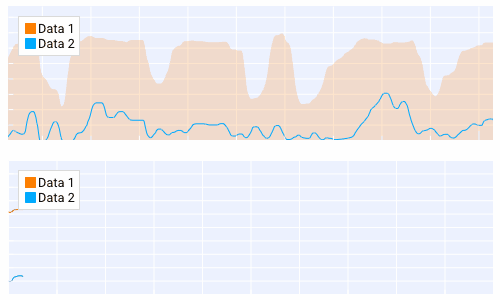
<span>实时绘图</span>
</a>

<a class="qim-gallery-item" href="plot2d/plot-bar-charts/">
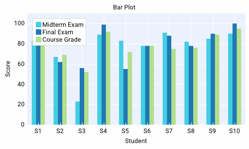
<span>柱状图</span>
</a>

<a class="qim-gallery-item" href="plot2d/plot-basic-charts/">
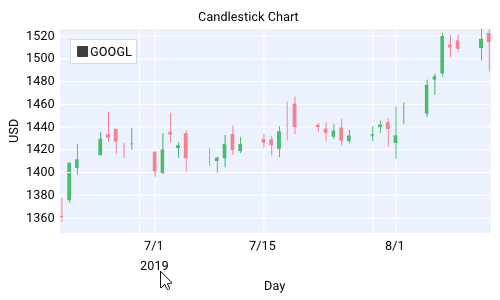
<span>K 线图</span>
</a>

<a class="qim-gallery-item" href="plot2d/plot-special-charts/">
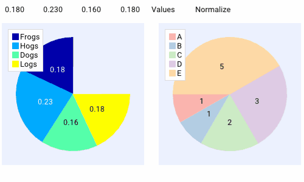
<span>饼图</span>
</a>

<a class="qim-gallery-item" href="plot2d/plot-special-charts/">
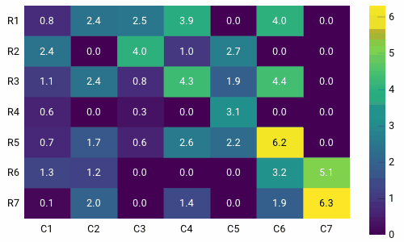
<span>热力图</span>
</a>

<a class="qim-gallery-item" href="plot2d/plot-area-charts/">
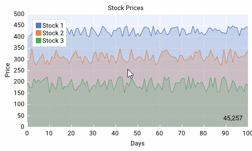
<span>填充区域</span>
</a>

<a class="qim-gallery-item" href="plot2d/plot-basic-charts/">
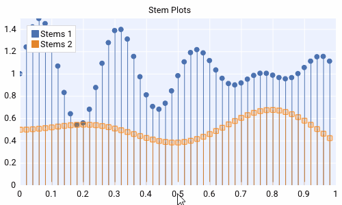
<span>茎叶图</span>
</a>

<a class="qim-gallery-item" href="plot2d/plot-special-charts/">
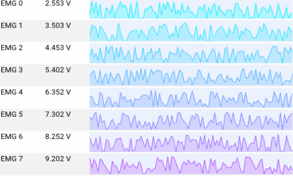
<span>表格</span>
</a>

<a class="qim-gallery-item" href="plot3d/">
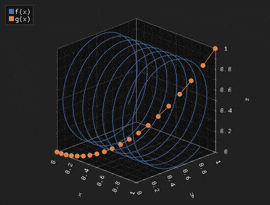
<span>三维曲面</span>
</a>

<a class="qim-gallery-item" href="plot3d/basic-charts/">
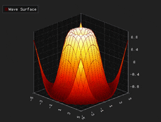
<span>三维散点</span>
</a>

<a class="qim-gallery-item" href="plot3d/mesh/">
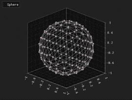
<span>三维网格</span>
</a>

<a class="qim-gallery-item" href="plot3d/surface-charts/">
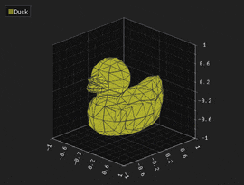
<span>三维可视化</span>
</a>

</div>

</div>

<div class="qim-quickstart" markdown>

<div class="qim-quickstart-inner" markdown>

<div class="qim-section-head">
<h2>快速开始</h2>
<p>几分钟内将 QIm 集成到你的 Qt 项目。</p>
</div>

=== "CMake 集成"

    ```cmake
    # 查找并链接 QIm
    find_package(QIm REQUIRED)

    target_link_libraries(${PROJECT_NAME} PRIVATE
        Qt${QT_VERSION_MAJOR}::Core
        Qt${QT_VERSION_MAJOR}::Gui
        Qt${QT_VERSION_MAJOR}::Widgets
        Qt${QT_VERSION_MAJOR}::OpenGL
        QIm::Core
        QIm::Widgets
    )

    # Qt6 需额外引入 OpenGLWidgets
    if(${QT_VERSION_MAJOR} EQUAL 6)
        target_link_libraries(${PROJECT_NAME} PRIVATE
            Qt${QT_VERSION_MAJOR}::OpenGLWidgets
        )
    endif()
    ```

=== "第一个 2D 图"

    ```cpp
    #include <QImFigureWidget.h>

    // 创建 2x2 子图网格的图窗
    auto* figure = new QIM::QImFigureWidget(this);
    figure->setSubplotGrid(2, 2);

    // 子图1 - 折线图
    if (auto* plot = figure->createPlotNode()) {
        plot->setTitle("正弦波");
        std::vector<double> x, y;
        for (int i = 0; i < 400; ++i) {
            double v = i * 2.0 * M_PI / 399.0;
            x.push_back(v);
            y.push_back(std::sin(v));
        }
        plot->addLine(x, y, "sin(x)");
    }

    // 子图2 - 散点图
    if (auto* plot = figure->createPlotNode()) {
        plot->setTitle("散点图");
        std::vector<double> x{0.2, 0.5, 0.9, 1.3, 1.8, 2.1, 2.6, 3.0};
        std::vector<double> y{1.4, 1.0, 1.8, 1.3, 2.0, 1.7, 2.3, 2.1};
        auto* scatter = new QIM::QImPlotScatterItemNode(plot);
        scatter->setData(x, y);
        scatter->setColor(QColor(0, 114, 189));
    }
    ```

=== "自定义节点"

    ```cpp
    // 继承 QImAbstractNode 封装任意 ImGui 组件
    class CustomPlotNode : public QImAbstractNode {
        Q_OBJECT
    public:
        CustomPlotNode(QObject* parent = nullptr) : QImAbstractNode(parent) {}

    protected:
        bool beginDraw() override {
            // 对应 ImGui::Begin("MyCustomWindow")
            return ImGui::Begin("MyCustomWindow", nullptr, m_flags);
        }

        void endDraw() override {
            ImGui::End();
        }

    private:
        ImGuiWindowFlags m_flags = 0;
    };
    ```

</div>
</div>

<div class="qim-footer">
<div class="qim-footer-inner">

<h2>立即开始构建</h2>
<p>查阅文档或浏览源代码。</p>

<div class="qim-footer-links">
<a href="plot2d/" class="qim-btn qim-btn-primary">阅读文档</a>
<a href="../" class="qim-btn qim-btn-ghost">English</a>
<a href="https://github.com/czyt1988/QIm" class="qim-btn qim-btn-ghost">GitHub</a>
</div>

</div>
</div>
